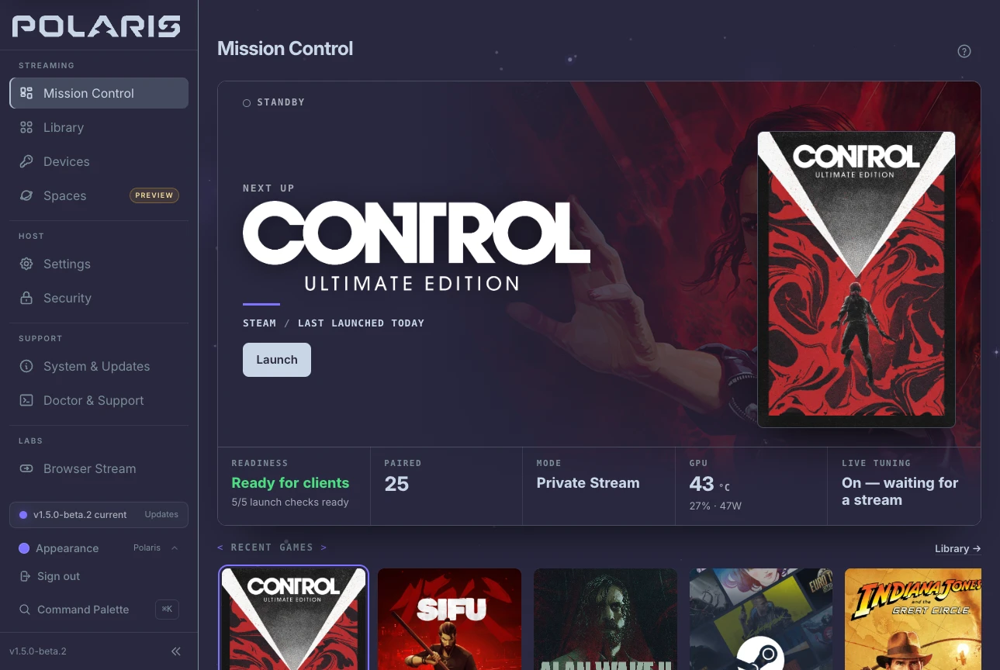

<div align="center">

<picture>
  <source media="(prefers-color-scheme: dark)" srcset="docs/screenshots/Polaris_fulllogo_2.svg">
  
</picture>

**Stream games from your Linux PC without giving up your desktop.**

Polaris turns a Linux gaming PC or a Steam Deck into your own game-streaming
host. Pick up a handheld, phone, tablet or TV, open Nova or a Moonlight client,
and play your library while your desktop stays exactly as you left it.

[](https://github.com/papi-ux/polaris/stargazers)
[](https://matrix.to/#/#papi-ux:papi-ux.com)
[](LICENSE)
[](https://github.com/papi-ux/polaris/releases/latest)

[**Get Polaris**](https://papi-ux.com/downloads/?product=polaris) ·
[Explore Polaris](https://papi-ux.com/polaris/) ·
[Quick start](https://papi-ux.com/docs/quickstart/) ·
[Join the Matrix community](https://matrix.to/#/#papi-ux:papi-ux.com)

</div>




<sub>Mission Control, the Polaris console in your browser: the next game, whether
the host is ready, how the game will launch and how your GPU is doing.</sub>

## What Polaris does

Give each game a space of its own, bring your library together, and manage it
from a browser. Polaris uses your GPU to stream and keeps you informed about
the connection. It's free, open source and self-hosted: there's no cloud account
or subscription, and pairing, settings and your library stay on your PC.

- **Your desktop stays yours.** Private Stream runs each game in its own
  invisible session, so your monitors, windows and layout stay put, and it
  can even run on a PC with no monitor attached. When you do want the real
  desktop, Mirror Desktop streams it, Host Virtual Display adds a screen sized
  to your client, and Gamescope Stream suits a Steam-first, Deck-style host.
  Each choice says what it will do to your screens, and one your PC can't run
  yet names what's missing instead of failing at launch.
- **A sharp picture from your own GPU.** Polaris encodes in hardware on NVIDIA,
  AMD and Intel graphics and keeps frames on the GPU when the capture path
  allows. It checks which of H.264, HEVC and AV1 your GPU can really encode
  before offering them to clients, streams HDR when the capture path delivers
  real HDR, and Live Tuning can adjust the bitrate to your network as you play.
- **You can see what's happening.** Mission Control shows what's playing,
  who's connected, a live quality grade with latency, frame rate and loss, and
  the capture path and encoder Polaris really chose. When the host is idle, it
  tells you whether it's ready to stream and the first thing to fix if it
  isn't. The console fits a phone or tablet as well as a desktop.
- **A Doctor for bad streams.** When a game feels wrong, Doctor tells you
  whether the network, the host or the client may be behind it. When it can help,
  it offers one safe fix, checks whether it worked and undoes it if it didn't.
- **Your library comes along.** Steam, Heroic (GOG and Epic), Lutris and ROM
  folders with their emulators arrive with artwork, and each game shows its
  launch checks before you press play.
- **Step away without losing your place.** Disconnect keeps the game running
  so you can resume later. End Session stops only the game that session
  started, and a second device can watch without taking over.
- **You decide what each device can do.** New pairings can browse, launch and
  play without clipboard, file or command access, and watch-only access is
  there for viewers.
- **It works with the clients you have.** Nova gets the richest experience:
  launch choices, Play Setup, watch and resume, Doctor and live tuning on the
  device in your hands. Moonlight and other compatible clients pair, browse and
  play too.

### Better with Nova

Nova is the client built for Polaris. It reads the launch modes your PC can
run, so Play Setup names where a game will run and at what resolution, frame
rate and codec before anything starts, and Command Center keeps the session's
controls a shortcut away. Nova runs on Android, with Linux, Steam Deck and
Steam Frame builds in Beta. [Meet Nova](https://papi-ux.com/nova/) or
[get the latest release](https://github.com/papi-ux/nova/releases/latest).


Want a different look? The console comes in a choice of themes under
**Appearance**.

## Get started

[**Get Polaris**](https://papi-ux.com/downloads/?product=polaris) helps you pick
the right package. If you'd rather choose yourself:

| Your Linux host | Start here |
| --- | --- |
| Fedora 44, Arch Linux, CachyOS | [Quick start](https://papi-ux.com/docs/quickstart/), with signed package repositories |
| SteamOS 3.8 or 3.9 on a Steam Deck | [SteamOS guide](https://papi-ux.com/docs/steamos/); stable has a 3.8 package, and 1.5.0-beta.2 adds a separate 3.9 package |
| Bazzite | [Bazzite guide](https://papi-ux.com/docs/bazzite/) |
| Ubuntu 24.04 | [Ubuntu guide](https://papi-ux.com/docs/ubuntu/), a tester package |
| NixOS | [NixOS guide](https://papi-ux.com/docs/nixos/), a source build with community validation |
| Something else | [Compatibility](https://papi-ux.com/docs/compatibility/) and [building from source](https://papi-ux.com/docs/building/) |

Most packages then need a one-time host setup:

```bash
sudo -H polaris --setup-host
polaris
```

**Fresh install:** open `https://localhost:47990/#/welcome` and create your account.
**Upgrade or reinstall:** sign in at `https://localhost:47990/#/login`. Your
pairing, settings and library stay in `~/.config/polaris`.

Add `--enable-kms` only when your capture guide asks for it. Setup names any
missing permission or dependency, but only a real stream shows your hardware
works. Then pair [Nova](https://papi-ux.com/nova/) or a Moonlight client and
play.

## Good to know

- **Linux only, on purpose.** Windows and macOS hosts aren't planned. Clients
  connect from their own platforms; the [client table](https://papi-ux.com/docs/compatibility/#clients)
  shows what each one gets.
- **Graphics.** NVIDIA is the most tested. AMD and Intel work through VAAPI,
  with software encoding as a fallback. Codecs and HDR depend on what your GPU
  and capture path can deliver; [Compatibility](https://papi-ux.com/docs/compatibility/)
  has the details.
- **Stable or beta.** [Latest](https://github.com/papi-ux/polaris/releases/latest)
  is always stable; betas are opt-in prereleases. This page follows the source,
  which can be ahead of the newest package. The [release notes](docs/release-notes/)
  and [changelog](docs/changelog.md) cover what changed in each version and
  what's still being checked.
- **Extras to try when you want them.** These stay out of the way until you
  choose them. [Spaces](https://papi-ux.com/docs/spaces/) (preview) gives each
  player their own launcher sign-in, library and saves on one PC.
  [PyroWave](https://papi-ux.com/docs/pyrowave/) (experimental) trades
  bandwidth for very fast decoding on a wired local network and runs only when
  a client asks for it. Browser Stream (experimental) plays in a web browser on
  your local network, best tested in Chromium-family browsers.
  [Recording](docs/configuration.md#recording-tab) (video only, no audio) and
  [source-paced VRR](docs/configuration.md#audio-and-video-tab) (experimental,
  not yet requested by Nova) are off by default.

## Learn more

- [Documentation](https://papi-ux.com/docs/) · [How the runtime works](https://papi-ux.com/docs/runtime/) · [Launch modes](https://papi-ux.com/docs/launch-modes/) · [Mission Control](https://papi-ux.com/docs/mission-control/) · [Doctor](https://papi-ux.com/docs/doctor/) · [Live Tuning](https://papi-ux.com/docs/live-tuning/) · [Library and artwork](https://papi-ux.com/docs/library-and-artwork/) · [Spaces](https://papi-ux.com/docs/spaces/) · [Emulators](https://papi-ux.com/docs/emulators/) · [Play with Moonlight](https://papi-ux.com/docs/moonlight/) · [FAQ](https://papi-ux.com/docs/faq/)
- [Roadmap](https://papi-ux.com/docs/roadmap/) · [Website changelog](https://papi-ux.com/docs/changelog/) · [Changelog](docs/changelog.md) · [Releases](https://github.com/papi-ux/polaris/releases)
- [Matrix community](https://matrix.to/#/#papi-ux:papi-ux.com) · [Issues](https://github.com/papi-ux/polaris/issues) · [Discussions](https://github.com/papi-ux/polaris/discussions) · [Security policy](SECURITY.md) · [Contributing](.github/CONTRIBUTING.md)

<sub>Screenshots: 1.5.0-beta.2 ([details](docs/screenshots/beta2/provenance.json)).
Website gallery: [image sources](https://papi-ux.com/images/products/showcase-v1.3.8-v1.3.6-provenance.json).</sub>

## Acknowledgments

Polaris builds on the Apollo and Sunshine host lineage and stays compatible
with the wider Moonlight ecosystem. Thanks to their maintainers and
communities for the foundation.

## AI Transparency

Polaris is maintainer-led. I use AI-assisted tools for research, debugging,
comparison and drafting, especially around unfamiliar compositor, packaging
and client behavior. They don't decide what Polaris is or what ships: I review
and test changes, and I own the final calls on validation, trust boundaries
and release quality.

## Contributing

Focused fixes, docs, translations, packaging and real-hardware testing are
welcome. Explain the problem, keep the change scoped and say what you tested on
Linux. Check the [current work and review queue](docs/product-objective-status.md)
first, then see [CONTRIBUTING](.github/CONTRIBUTING.md).

## License

Polaris is free and open-source software under the [GNU General Public License v3.0](LICENSE).

<div align="center">


<picture>
  <source media="(prefers-color-scheme: dark)" srcset="docs/screenshots/polaris-icon-darkmode.svg">
  
</picture>

<sub>[Website](https://papi-ux.com/polaris/) · [Matrix](https://matrix.to/#/#papi-ux:papi-ux.com) · [Documentation](https://papi-ux.com/docs/) · [Releases](https://github.com/papi-ux/polaris/releases) · [Security](SECURITY.md)</sub>

</div>
